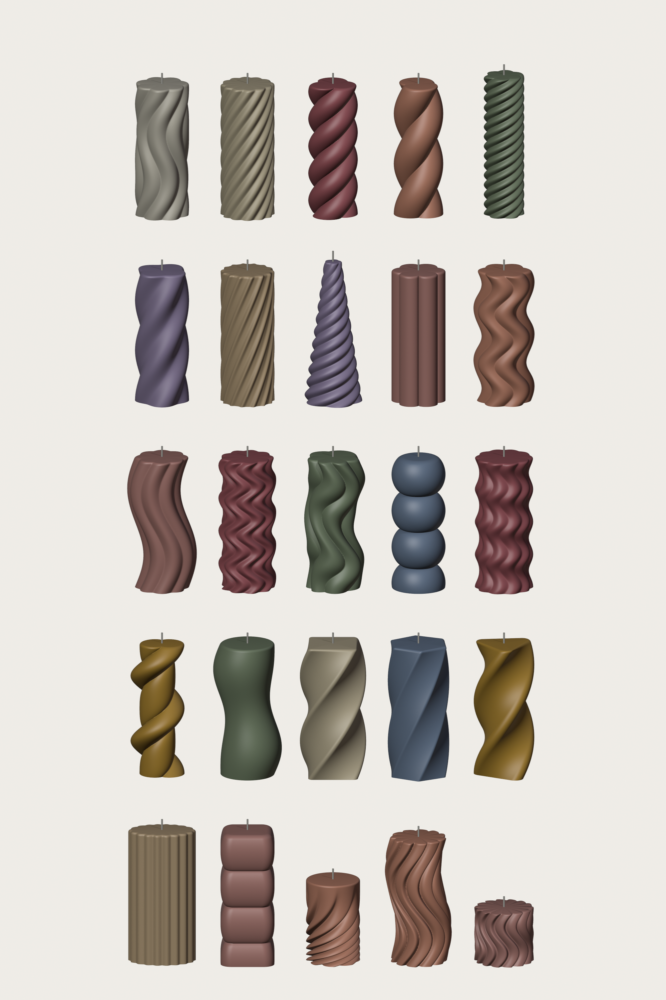
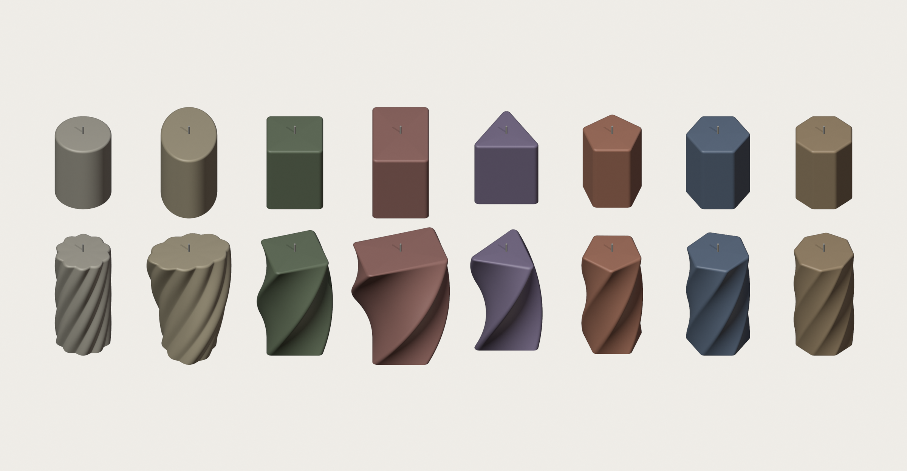
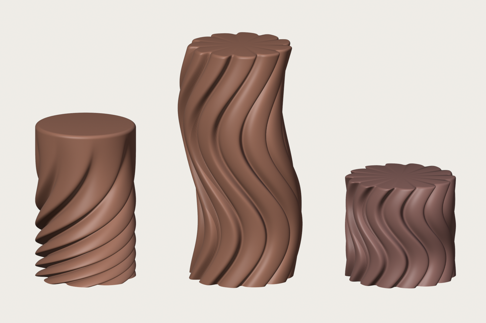
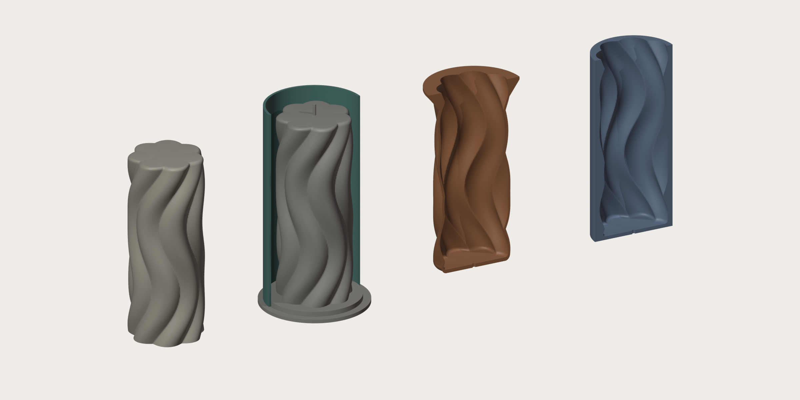
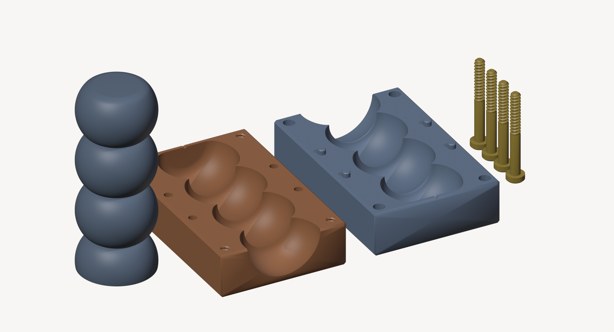
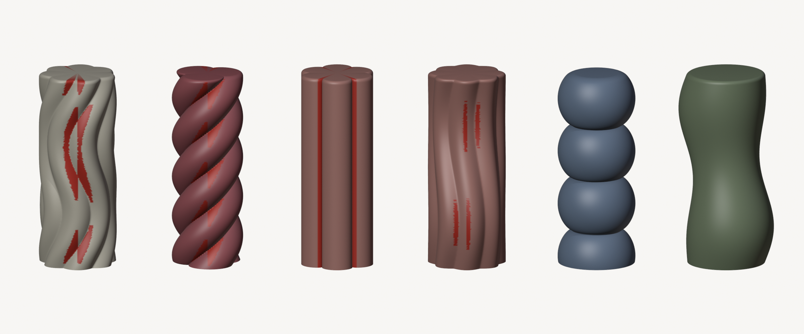
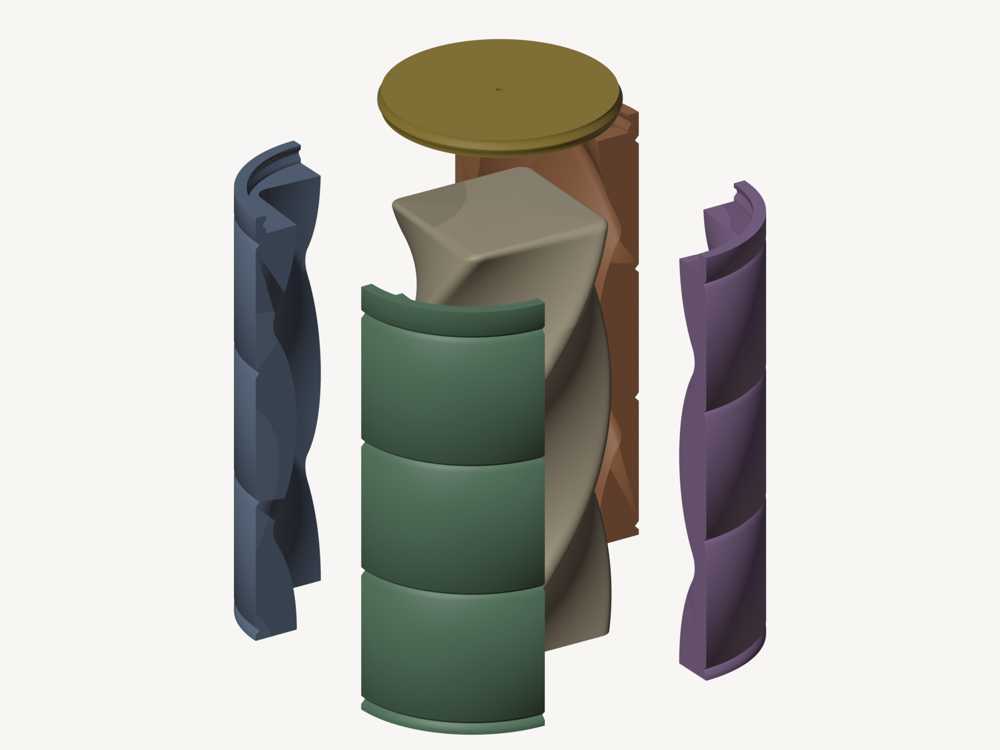
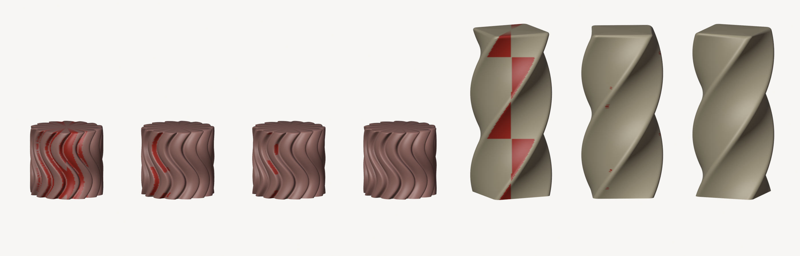

# Candle Studio

A Blender add-on (`candle_studio.py`) for designing swirl, twist, wave and bubble pillar candles with sliders, then exporting print-ready molds for Bambu Studio.



## Install

Blender 4.2 or newer (tested on 5.2).

1. **Edit → Preferences → Add-ons → ⌄ (top right) → Install from Disk…** and pick `candle_studio.py`, then tick it.
   To try it without installing, open the file in Blender's **Text Editor** and press **Run Script**.
2. In the 3D Viewport press **N** and open the **Candle** tab. Click **Create / Refresh Candle**.

The scene switches to millimetres (1 Blender unit = 1 mm).

## Designing

Pick a preset, then adjust the sliders. The candle updates as you drag. **Surprise Me** makes a random design at your current shape and size. The **Defaults** preset (first in the list) starts fresh: every shape and mold setting goes back to its default. Your export name, folder and viewport detail stay as they are.

| Panel | Controls | What they do |
|---|---|---|
| Shape & Size | Shape | The starting cross-section: Round, Oval, Square, Rectangle, Triangle, Pentagon, Hexagon or Octagon |
| | Length Ratio, Corner Round | Oval and rectangle: how long they are compared with their width. Straight-sided shapes: the radius of the rounded corners (a large value gives a soft, pebble-like shape) |
| | Height, Diameter / Width, Top Size, Taper Curve, Top Edge Round | Overall shape. Width is measured across the flat sides; for a triangle or pentagon, from a flat side to the opposite corner. Set Top Size below 1 for a cone or pyramid |
| Ribs, Twist & Sway | Ribs, Rib Depth, Rib Fullness | Number and depth of the lobes, spaced evenly around the outline. Fullness above 0 gives fat rope or flower lobes, below 0 gives thin fluted ridges |
| | Rib Lean | Tilts every rib: one steep side and one gentle side, like overlapping folds or fins. The sign sets which way |
| | Fade Bottom, Fade Top | The ribs ease out to a smooth surface over this share of the height (in %), at the bottom and/or the top |
| | Twist | Full turns of spiral over the height. A negative value twists the other way. On a non-round shape the whole shape twists, so a square with Twist becomes a twisted square pillar |
| | Twist Focus | Where the twist is tightest. 0 is even; a positive value is tight at the bottom and straightens out going up; a negative value is the reverse |
| | Sway, Sway Waves, Phase, Stagger | Ribs swing left and right, like your first photo. With Stagger 1 the ribs drift out of sync for an organic look |
| Waves & Bulges | S-Wave / Corkscrew | The whole candle bends side to side, or winds around in a helix |
| | Soft / Bubbles | The width swells and narrows, or forms stacked bubbles |

The panel shows the wax needed (ml, and grams of soy wax at 0.86 g/ml) and, for the silicone route, the silicone needed.

### Starting shapes


*Top: the eight starting shapes (Round, Oval, Square, Rectangle, Triangle, Pentagon, Hexagon, Octagon). Bottom: the same shapes with 0.3 turns of Twist.*

### Folds and fades


*Swirl Fade, Draped S-Curve and Wave Fins.*

Leaning ribs give the layered, draped look of overlapping folds. Combine Rib Lean with a negative Rib Fullness for crisp edges:
- **Swirl Fade**: folds swirl tightly at the bottom (Twist Focus) and fade into a smooth top (Fade Top 50%).
- **Draped S-Curve**: leaning folds that sway over an S-bend.
- **Wave Fins**: a short pillar of leaning fins with one wave.

Where leaning ribs turn quickly, the add-on automatically adds extra rings so the steep sides stay smooth.

Every pattern works on every shape: ribs, sway, waves and bubbles follow the outline. The presets Twisted Square, Twisted Hexagon, Twisted Triangle, Ribbed Oval and Square Cushions are good places to start. Keep a few millimetres of Corner Round: sharp corners chip easily and are hard to get out of a mold cleanly.

## Molds


*From left: the candle; the silicone master inside a cut-away sleeve; the TPU mold (cut away); the rigid mold (cut away).*

| Mold | Prints | Use it for |
|---|---|---|
| **Silicone mold kit** (recommended) | `master` (candle on a base plate with a wick pin) and `sleeve`, in PLA | Every design. Gives the smoothest candles |
| **Printed two-part mold** | `half_a`, `half_b` and `screws_x4`, in PLA or PETG | Shapes that release from two rigid halves. The panel checks each design and paints the problem areas red |
| **Printed wedge mold** | `wedge_1` to `wedge_6` and `plug`, in PLA or PETG | Twists, sways and waves that grip two halves. Uses 3 to 6 wedges, as many as the design needs |
| **Printed flexible mold (TPU)** | `mold_flex`: a 1.8 mm shell that follows the candle, with a rim | Casting straight from the printer. Peel it off the candle |
| **Printed rigid mold (PETG)** | `mold_rigid`: a solid block | Twist-only designs, which you unscrew out of the mold. The panel says whether your shape qualifies |

### Filament estimate

The Mold panel shows about how many grams of filament the mold takes, per part and in total. The number updates a moment after you stop dragging. Set **Infill for estimate** to the sparse infill you'll slice with: 10–15% is plenty for molds, and Bambu Studio's default is 15%. The estimate assumes Bambu's other defaults (2 walls, 5 top and 3 bottom layers). Thin-walled parts such as the sleeve are counted solid, as the slicer prints them. The printed screws are counted solid too, because they should be printed at 100% infill. The export message repeats the total, worked out from the exported files.

Checked against Bambu Studio's slicer (0.2 mm Standard, 15% infill), every part came out within about 4%.

### Silicone kit
1. Print the master and sleeve in PLA. Use fine layers (0.08–0.12 mm), because the silicone copies every layer line. Sanding, or one coat of primer or XTC-3D, gives glossy candles.
2. Slide the sleeve over the step on the base plate. Seal the joint with hot glue or clay.
3. Pour silicone up to just below the sleeve rim. The wick pin sticks out through the top, so it leaves a ready-made wick hole.
4. Once cured, pull off the sleeve and peel the silicone off the master. For deep swirls, a slit down one side makes demolding easier.
5. To cast: stand the mold opening-up, thread the wick through the hole, and pour.

### Two-part mold



A classic block mold: two halves, 4 alignment pins and 4 printed screws. One end of the block is the pour opening (the candle's base) and the other end has the wick hole.

**Will it release?** With this mold type selected, the add-on finds the seam angle that traps the least and paints the parts of the candle that would grip the mold red. The red appears a moment after you stop dragging a slider. If the panel says *Releases cleanly*, the halves will pull straight off. Hooks thinner than 0.3 mm don't count: the wax shrinks away from them.


*Red = grips a two-part mold. From left: Classic Swirl, Rope Twist, Petal, S-Curve, Bubble Stack, Curvy Form.*

- Releases: smooth shapes (bubbles, curves, plain pillars), straight, even-numbered ribs that aren't too fat, and every untwisted starting shape (a triangle or pentagon only splits along its mirror line, and the auto seam finds it).
- Locks: anything with twist or sway, because at some height the ribs or corners face the seam. Use the wedge mold for those: most come out of 3 or 4 wedges. Otherwise use the silicone or TPU mold. A twist-only design (such as Twisted Square) can also unscrew from the one-piece rigid mold.
- Print both halves as exported: lying on their backs, seam side up. The cavity faces up, so no supports are needed. Ironing the top surface gives a tighter seam.
- **Hold Together**:
  - *Printed screws*: 8 mm thread, printed into half A. Print the 4 screws head-down at 100% infill.
  - *M5 bolts + nuts*: the export message gives the bolt length.
  - *Clamps*: pins only.
- Spray mold release before pouring. Seal the outside of the seam with a little mold putty if it seeps.

### Wedge mold


*Twisted Square: the candle, its 4 wedges pulled out, and the plug lifted off the top.*

A round sleeve split into 3 to 6 wedges, plus a plug for the candle's top. Two halves each have to slide off half of the candle, and at the seam the sides of the ribs and corners face sideways, so they grip. A wedge only covers a third to a sixth of the way round, so much more comes out cleanly, including twists, sways and waves.

- **Pieces**: with **Auto Pieces** on, the add-on uses the fewest wedges that release and shows how many. Turn it off to choose 3 to 6 yourself; the panel then checks that number. More wedges release deeper and twistier designs, but each one leaves another faint seam line on the candle.
- **Will it release?** As with the two-part mold, the panel paints the places that would grip red, a moment after you stop dragging. The check pulls each wedge straight out from the centre and works like the two-part check.
- Of the presets, 17 release from 3 wedges. Rope Twist, Organic Waves, Twisted Square and Twisted Triangle need 4, Curved Spiral needs 5 and Wave Fins needs 6. Swirl Fade and Draped S-Curve still grip with 6 wedges: use silicone or TPU for those.


*Red = grips the mold. Wave Fins in 2 (the two-part mold), 3, 4 and 6 pieces; Twisted Square in 2, 3 and 4.*

- **Printing**: print the wedges as exported, standing on the pour end, and the plug face up. Use PLA or PETG. Most designs need no supports. Bubbles and deep, tight spirals (Bubble Stack, Curved Spiral, Rope Twist) have 60–70° overhangs in places inside the cavity: they print, but come out rougher there. Bubble designs also release from the two-part mold, which prints with the cavity facing up.
- **Assembly**: put the plug on the table, recess up, and stand the wedges around it so its rim slots into their grooves. Put a rubber band (or a hair tie) in each groove round the outside. The plug end is the candle's top: thread the wick through the plug's hole and pour through the open end.
- **Release**: once the candle has cooled, take the bands off, pull the wedges straight out one at a time, then lift the plug off. Spray mold release before pouring, and seal the outside of the seams with a little mold putty if they seep.

### Flexible TPU mold
- Print in TPU 95A from the external spool (the AMS can't feed TPU). Print it as exported, floor down. The rim has a 45° underside, so it needs no supports.
- Hang it in a jar by the rim while you pour. Pour at the low end of your wax's pouring temperature.

### Rigid mold
- Print in PETG, because PLA softens around 60 °C. Use mold release, let the candle cool fully, then twist it out along the spiral. This also works for twisted squares, hexagons and other twisted shapes, as long as nothing sways, waves or bulges. The twist must be even (Twist Focus 0), and ribs mustn't fade at the top. A faded bottom is fine on a straight design, since it slides straight out.

## Export to Bambu Studio

**Export for Bambu Studio** writes the following to the export folder. By default that's `candle_exports/` next to your .blend file, or `~/Documents/Candle Studio` if the file isn't saved.

- `<name>_master.stl` + `<name>_sleeve.stl`, `<name>_half_a.stl` + `<name>_half_b.stl` + `<name>_screws_x4.stl`, `<name>_wedge_1.stl` … `<name>_wedge_N.stl` + `<name>_plug.stl`, `<name>_mold_flex.stl`, or `<name>_mold_rigid.stl`, depending on the mold type. All are in mm, already turned to print orientation and sitting on z = 0.
- `<name>_design.json`: every setting, so **Load Design** can bring the design back later.
- Tick *Also export candle shape* if you want the plain candle as well.

With **Open in Bambu Studio** ticked, the files open there automatically. If Bambu asks whether to load them as one object with multiple parts, answer **No**.

The meshes are built as closed surfaces; only the two-part halves and the wedges use Blender's boolean (Manifold solver) to cut the cavity, pins, threads and plug socket. Bambu Studio's own check reports `manifold = yes` with nothing to repair.

Export quality: **Draft** for test prints, **Fine** (the default, about 12 MB per part), **Ultra** for very smooth masters.

## Tests

The tests run inside Blender in background mode. Each one uses a throwaway Blender profile, so your own settings and add-ons aren't touched.

```bash
python3 tests/run_tests.py
```

A full run takes about 3 minutes. To run only some tests, name them (for example `python3 tests/run_tests.py shapes ui`), and add `-v` to see every check. The runner finds Blender on your PATH or in the usual install folder; set `BLENDER=/path/to/blender` to pick a specific one.

| Test | Checks |
|---|---|
| `geometry` | Every preset's candle, silicone kit, rigid and TPU mold is a clean, closed solid; operators, export and Load Design |
| `two_part` | The release check (which presets release), both halves and the screws for every preset, M5 and clamp variants, thread clearance, the live lock painting |
| `wedge` | The wedge release check (two wedges must agree with the two-part check), how many wedges each preset needs, every preset's wedges and plug, the plug's fit, the filament estimate, the live lock painting, preview and export |
| `shapes` | Exact widths, straight flat sides, rib spacing, plain shapes releasing, and every mold for 7 shapes × 7 pattern mixes (the wedge mold for 3 of the mixes) |
| `patterns` | Rib Lean, Fade and Twist Focus: what they do, that they change nothing at 0, the extra rings, the rigid-mold check, and every mold for the three fold presets |
| `ui` | Panels for every shape and mold type, presets, Defaults, Surprise Me, saving and loading designs, the filament estimate |
| `install` | Installs the file as a real add-on and exports every mold type |
